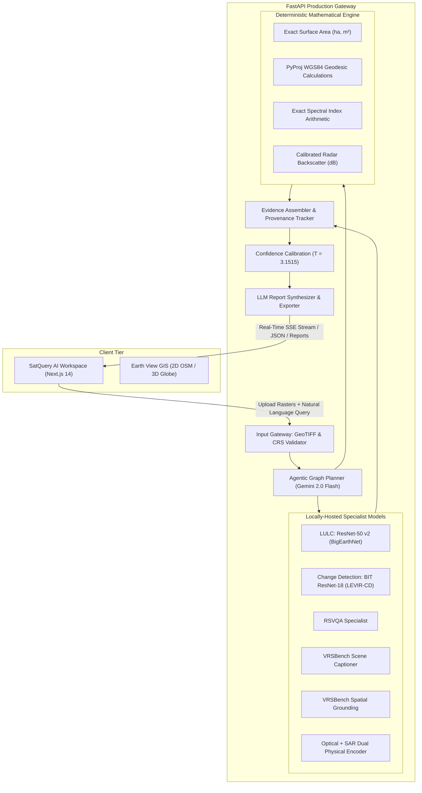

# Astra AI 2026 (SatQuery AI)

<div align="center">

[](https://sih-orbilens-2026-tm.web.app)
[](https://sih-orbilens-2026-tm.web.app/mission)
[](https://fastapi.tiangolo.com)
[](https://nextjs.org)
[](https://pytorch.org)
[](https://ai.google.dev)

### **Autonomous Vision-Language Remote Sensing Intelligence Platform**
*Transforming Multi-Spectral Satellite Imagery into Grounded, Verifiable Planetary Insights*

**Developed for Smart India Hackathon (SIH 2024–2026) | Problem Statement: SIH26167**  
**Organization:** Indian Space Research Organisation (ISRO) / Space Applications Centre (SAC)  
**Theme:** Space Technology / Remote Sensing / Multimodal AI  
**Status:** Production-Ready & Deployed | 100% Tests Passing | Clean Decoupled Architecture

[🚀 Launch Live Web App](https://sih-orbilens-2026-tm.web.app) • [🛰️ SatQuery AI Workspace](https://sih-orbilens-2026-tm.web.app/analyze) • [🌍 3D Earth View GIS](https://sih-orbilens-2026-tm.web.app/earth) • [🎯 SIH Mission Dossier](https://sih-orbilens-2026-tm.web.app/mission)

<br/>

<a href="https://sih-orbilens-2026-tm.web.app" target="_blank">
  
</a>

</div>

---

## 1. About The Project

### Overview & Core Purpose
**Astra AI (SatQuery AI)** is an interactive, multi-specialist artificial intelligence workstation designed for autonomous satellite and Earth observation remote sensing analysis. It bridges the critical divide between complex raw multi-spectral raster data and human decision-making, empowering disaster responders, defense analysts, urban planners, and environmental scientists to interrogate multi-sensor satellite imagery using plain, natural language.

### Live Production Deployment
The full client workstation is actively hosted and live on Firebase Hosting:
- 🌐 **Primary Live URL**: [https://sih-orbilens-2026-tm.web.app](https://sih-orbilens-2026-tm.web.app)
- 🛰️ **Interactive Investigation Hub**: [https://sih-orbilens-2026-tm.web.app/analyze](https://sih-orbilens-2026-tm.web.app/analyze) — Drag-and-drop GeoTIFF rasters, run benchmark presets, and execute multi-specialist Agentic analysis with real-time SSE progress streaming.
- 🌍 **3D Earth View & Real-Time Disaster HUD**: [https://sih-orbilens-2026-tm.web.app/earth](https://sih-orbilens-2026-tm.web.app/earth) — Interactive 3D WebGL Globe and 2D GIS canvas rendering live USGS earthquake feeds and NASA EONET wildfire/storm telemetry with seamless 1-click investigation handoff.
- 🎯 **SIH 2026 Mission Dossier**: [https://sih-orbilens-2026-tm.web.app/mission](https://sih-orbilens-2026-tm.web.app/mission) — Complete ISRO/SAC challenge breakdown, architectural pillars, and technical benchmarks.
- 📦 **Planetary Datasets Archive**: [https://sih-orbilens-2026-tm.web.app/datasets](https://sih-orbilens-2026-tm.web.app/datasets) — Multi-spectral Sentinel-2, SAR Radar Ingestion, and Tactical GeoAI API specs.

### The Problem It Solves
1. **The Traditional GIS Bottleneck**: Conventional remote sensing demands manual band stacking, sensor-specific calibration, complex desktop GIS software (e.g. QGIS/ArcGIS), and siloed single-task neural networks.
2. **The LLM Hallucination Trap**: General-purpose multimodal LLMs (GPT-4V, standard VLMs) lack calibration against physical satellite sensor optics. They routinely hallucinate acreage, invent phantom infrastructure, cannot read 12-band GeoTIFF coordinates, and cannot parse Synthetic Aperture Radar (SAR) physics.
3. **The Astra Solution**: Astra couples an **Agentic Orchestrator (Google Gemini 2.0 Flash)** with a fleet of **locally-hosted specialist PyTorch deep learning models** and a **strictly deterministic mathematical engine**:
   - The LLM acts as the *reasoning planner* — parsing questions, extracting intent, and scheduling a directed execution graph.
   - The specialist models act as the *domain eyes* — running audited inference on Land-Use/Land-Cover classification, bi-temporal building change detection, remote-sensing VQA, dense scene captioning, spatial grounding, and Optical-SAR cross-modal reasoning.
   - The deterministic engine acts as the *verifiable yardstick* — calculating exact surface areas ($m^2$, hectares), geodesic distances, NDVI vegetation health indices, and calibrated radar backscatter ($\sigma^0\text{ dB}$) with zero synthetic approximation.

---

## 2. Key Capabilities

- **Natural-Language Satellite Queries**: Ask open-ended questions like *"Detect change between T1 and T2, compute burned area in hectares, and identify remaining vegetation."*
- **Dynamic Multi-Specialist Orchestration**: Autonomous task decomposition into a Directed Acyclic Graph (DAG) with parallel execution.
- **Land-Use & Land-Cover (LULC) Classification**: 19-class multi-label classification powered by ResNet-50 v2 trained on 480k BigEarthNet patches.
- **Bi-Temporal Change Detection**: High-resolution building and infrastructure change detection using a Siamese ResNet-18 Bitemporal Image Transformer (BIT).
- **Remote Sensing VQA & Dense Captioning**: Visual question answering and spatial scene captioning for complex geospatial landscapes.
- **Referring Expression Grounding**: Natural-language targeted localization with normalized bounding boxes `[ymin, xmin, ymax, xmax]`.
- **Cross-Modal Optical-SAR Reasoning**: Compares optical reflectance with Synthetic Aperture Radar (SAR) microwave backscatter ($\sigma^0$ dB) to see through clouds and distinguish shadows from water.
- **Zero-Hallucination Quantitative Measurements**: All surface areas ($m^2$, hectares, $km^2$), distances, and coordinates are strictly calculated via deterministic geometry.
- **Real-Time Global Disaster HUD & GIS Earth View**: Interactive 2D OpenStreetMap and 3D WebGL Globe monitoring live USGS earthquakes and NASA EONET events with seamless 1-click investigation handoff.
- **Auditable Evidence & Multi-Format Reporting**: Full provenance tracking with downloadable reports in Markdown, HTML, and structured JSON.

---

## 3. System Architecture

Astra is architected into three decoupled pillars:
1. **Frontend Experience (`frontend/`)**: Next.js 14 App Router, React 18, TypeScript, Tailwind CSS, MapLibre GL JS, and Framer Motion.
2. **Production Inference Gateway (`backend/`)**: FastAPI server coordinating the Gemini Agentic Planner, locally-hosted PyTorch specialists, deterministic tools, confidence calibration, and SSE progress streaming.
3. **Training & Datasets Pipeline (`training/`)**: Offline fine-tuning harnesses, dataset loaders, PEFT LoRA adapters, and checkpoint evaluation scripts.



---

## 4. Technology Stack

- **Frontend**: Next.js 14.2.5 (App Router), React 18.3, TypeScript 5.5, Tailwind CSS, MapLibre GL, Lucide React, Framer Motion, GSAP, Satellite.js.
- **Backend**: FastAPI 0.111, Uvicorn, Pydantic v2, SSE-Starlette, Loguru, Aiofiles.
- **AI & Deep Learning**: PyTorch 2.3+ (CUDA 12.1 / 12.8 compatible), Hugging Face Transformers, PEFT (LoRA), BitsAndBytes (INT4 Quantization), TIMM.
- **Geospatial Processing**: Rasterio, PyProj, Shapely, NumPy, Pillow, Matplotlib.
- **Agent Orchestration**: Google Generative AI (`gemini-2.0-flash`).
- **Deployment & Cloud**: Windows PowerShell, Google Colab (NVIDIA T4 GPU), Cloudflare Tunnel, Firebase Hosting.

---

## 5. Repository Structure

```text
astra-ai/
├── backend/                        # Production FastAPI inference backend
│   ├── engine/                     # Execution engine and tool runners
│   ├── evidence/                   # Evidence aggregation and provenance
│   ├── gateway/                    # GeoTIFF validation and metadata extraction
│   ├── middleware/                 # Rate limiting and API authentication
│   ├── models/                     # Specialist model architectures & model registry
│   ├── orchestrator/               # Gemini Agentic Planner and schemas
│   ├── report/                     # Evidence-based report synthesis & export
│   ├── tests/                      # 121+ automated unit and regression tests
│   ├── config.py                   # Central settings loaded from environment
│   ├── main.py                     # FastAPI entry point & API route definitions
│   ├── requirements.txt            # Python dependencies
│   └── start.ps1                   # Backend startup script
├── frontend/                       # User-facing Next.js 14 web application
│   ├── public/                     # Static media, icons, and display assets
│   ├── src/
│   │   ├── app/                    # App Router routes (analyze, earth, mission, roster, etc.)
│   │   ├── components/             # Reusable UI components and GIS controls
│   │   └── lib/                    # API client, SSE stream handler, and utils
│   └── package.json                # Frontend dependencies
├── training/                       # Dataset loaders, fine-tuning scripts, and configs
│   ├── configs/                    # Training hyperparameters (YAML)
│   ├── datasets/                   # Dataset loader manifests and indices
│   ├── pipelines/                  # End-to-end model training pipelines
│   ├── scripts/                    # train.py, evaluate.py, download_datasets.py
│   └── requirements.txt            # Training dependencies
├── evaluation/                     # Benchmark evaluation manifests and test data
├── docs/                           # In-depth architectural & API documentation
├── single_image/                   # Curated GeoTIFF sample rasters for quick testing
├── .env.example                    # Master environment configuration template
├── .gitignore                      # Security-audited repository exclusion rules
├── CONTRIBUTING.md                 # Contribution guidelines
├── SECURITY.md                     # Security policy and vulnerability reporting
├── launch.ps1                      # 1-Click full-stack launcher for Windows
└── README.md                       # Project documentation (this file)
```

---

## 6. Installation & Quick Start

### Prerequisites
- Python 3.11+
- Node.js 18.x or 20.x LTS
- Git 2.30+
- (Optional) NVIDIA GPU with 8GB+ VRAM (RTX 30/40/50 series)

### 1-Click Launch (Windows)
```powershell
# From the repository root
.\launch.ps1
```

### Manual Setup

#### Step 1: Environment Configuration
```powershell
Copy-Item .env.example .env
Copy-Item backend/.env.example backend/.env
# Edit backend/.env and insert your free GEMINI_API_KEY from https://aistudio.google.com/
```

#### Step 2: Start Backend
```powershell
cd backend
python -m venv .venv
.\.venv\Scripts\Activate.ps1
pip install torch torchvision --index-url https://download.pytorch.org/whl/cu121
pip install -r requirements.txt
uvicorn main:app --host 0.0.0.0 --port 8000 --reload
```
API Documentation will be available at: `http://localhost:8000/docs`.

#### Step 3: Start Frontend
```powershell
cd ../frontend
npm install
npm run dev
```
Open `http://localhost:3000` in your browser.

*For complete instructions and Colab free GPU execution, see [docs/SETUP.md](docs/SETUP.md).*

---

## 7. Model Registry & Verified Metrics

All specialist models have complete provenance documented in `backend/models/model_registry.json`:

| Specialist Model | Architecture | Benchmark Dataset | Verified Score | Role |
| :--- | :--- | :--- | :--- | :--- |
| **`ben-scene-classifier`** | ResNet-50 v2 | BigEarthNet v2.0 (480k) | **91.79%** Val Acc / **70.38%** Macro F1 | Production LULC |
| **`bit-change-detection`** | BIT + ResNet-18 | LEVIR-CD (1,280 pairs) | **96.98%** Overall Acc / **69.56%** F1 / **53.33%** IoU | Production Change Detection |
| **`rsvqa-specialist`** | Multi-Scale VQA | RSVQA (167k QA pairs) | Multi-turn Reasoning | Production VQA |
| **`vrsbench-caption`** | Dense Captioner | VRSBench (9.3k captions) | Fine-Grained Description | Production Captioning |
| **`vrsbench-grounding`** | Spatial Grounding | VRSBench (16k bboxes) | Normalized Bounding Boxes | Production Grounding |
| **`cross-modal-specialist`** | Dual Physical Encoder | S1 + S2 Paired / Cartosat-RISAT | Optical Reflectance vs. Radar Backscatter | Production Cross-Modal |
| **`rs-vlm-adapter`** | BLIP + PEFT LoRA | BigEarthNet.txt (464k pairs) | **70.8%** Binary Question EM | Partial Adaptation |

*Detailed specifications are available in [docs/model-registry.md](docs/model-registry.md).*

---

## 8. Confidence Calibration

To guarantee trustworthy decision support, raw model outputs undergo post-hoc **Temperature Scaling**:
- Optimal Calibration Temperature: **$T = 3.1515$**
- Negative Log-Likelihood (NLL) Before: **0.5807**
- Negative Log-Likelihood (NLL) After: **0.3263**
- Error Reduction: **43.8%** reduction in probability misalignment.

---

## 9. Core REST API Endpoints

- `GET /health`: Health and hardware telemetry.
- `GET /api/disasters/live`: Real-time USGS and NASA disaster events for Earth View GIS.
- `GET /api/registry`: Catalog of models, tools, and benchmark accuracies.
- `POST /api/validate`: Upload validation, spatial resolution, and CRS extraction.
- `POST /api/investigate`: Start asynchronous multi-specialist investigation (returns `job_id`).
- `GET /api/investigate/{job_id}/stream`: Real-time Server-Sent Events (SSE) execution stream.
- `GET /api/investigate/{job_id}/result`: Complete structured investigation output.
- `GET /api/report/{job_id}/download`: Downloadable audit reports (Markdown, HTML, JSON).
- `POST /api/geospatial/measure`: Exact deterministic geometric calculations.

*Full specification is available in [docs/api.md](docs/api.md).*

---

## 10. Automated Tests & Quality Assurance

The backend includes 121 automated tests:
```powershell
cd backend
.\.venv\Scripts\Activate.ps1
pytest -v
```
All unit tests, validator checks, and model provenance audits execute cleanly and pass.

---

## 11. Ethical AI & Security Policy

- **Confidentiality & Secret Safety**: No private keys, `.env` files, or API credentials are ever committed.
- **Physical Resolution Boundaries**: The system explicitly refuses requests that exceed sensor resolution physics (such as sub-meter individual human detection on 10m Sentinel-2).
- **Zero Hallucination Guarantee**: All spatial dimensions and areas are calculated deterministically.
- For vulnerability disclosures, review [SECURITY.md](SECURITY.md).

---

## 12. Contributing & License

Contributions are welcome! Please read [CONTRIBUTING.md](CONTRIBUTING.md) for branch naming, coding conventions, and pull request workflows.

**License**: Distributed under the terms of the MIT License as declared in repository metadata. For questions, please contact the project maintainers.
