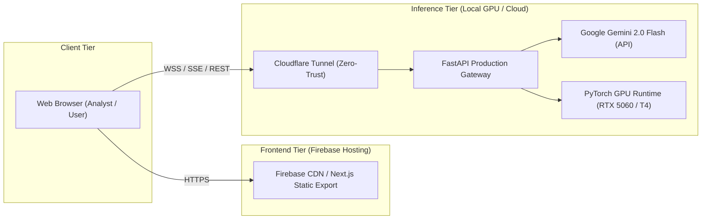

# Astra AI — Deployment & Infrastructure Architecture

This guide outlines deployment architectures for Astra AI across local workstations, cloud GPUs, and static hosting platforms.

---

## 1. Architecture Topology



---

## 2. Deployment Scenarios

### Scenario A: Local Workstation (NVIDIA RTX 50-Series / 40-Series)
- **Use Case**: On-premise, secure, private GIS workstations.
- **Backend**: FastAPI running locally on port 8000 via [launch.ps1](../launch.ps1).
- **Frontend**: Next.js development or production server on port 3000.
- **Hardware Profile**: 8GB–16GB VRAM; INT4 quantization enabled via `USE_INT4_QUANTIZATION=true` in `backend/.env`.

### Scenario B: Hybrid Cloud (Firebase Frontend + Google Colab Backend)
- **Use Case**: Zero-cost cloud demonstration with full GPU capability.
- **Frontend**: Hosted on Firebase Hosting at `https://sih-orbilens-2026-tm.web.app`.
- **Backend**: Hosted on Google Colab (NVIDIA T4 GPU) via [Astra_Colab_Backend.ipynb](../Astra_Colab_Backend.ipynb).
- **Network Bridge**: Cloudflare Tunnel dynamically connects the browser to the Colab container without public port forwarding or dynamic DNS.

### Scenario C: Linux Production Server (Ubuntu 22.04 LTS / Docker)
- **Backend Service**: Systemd service or Docker container executing `uvicorn main:app --host 0.0.0.0 --port 8000 --workers 2`.
- **Reverse Proxy**: Nginx or Traefik terminating TLS/HTTPS and proxying SSE connections with buffering disabled:
  ```nginx
  location /api/investigate/ {
      proxy_pass http://127.0.0.1:8000;
      proxy_set_header Connection '';
      proxy_http_version 1.1;
      chunked_transfer_encoding off;
      proxy_buffering off;
      proxy_cache off;
  }
  ```

---

## 3. Production Security Checklist

- [x] **Zero Secret Storage**: No API keys bundled in client-side code; `GEMINI_API_KEY` accessed exclusively server-side.
- [x] **CORS Origin Whitelisting**: Strict `ALLOWED_ORIGINS` enforced in `backend/config.py`.
- [x] **File Ingestion Sanitization**: Max file size bounded at 200MB; MIME validation and GeoTIFF header verification before disk storage.
- [x] **Rate Limiting**: Integrated `middleware/rate_limit.py` protects against denial-of-service and API budget depletion.
- [x] **Ephemeral Job Cleanup**: Asynchronous background cleanup task (`_cleanup_jobs_loop`) purges in-memory job queues and temporary rasters every 60 minutes.
