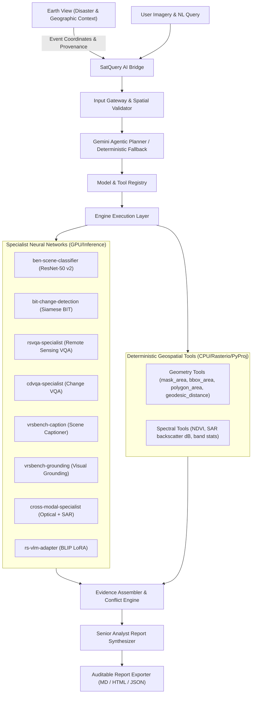

# SIH26167 — Current Product Audit & System Verification
**Project**: Astra AI / SatQuery AI  
**Problem Statement**: SIH26167 — Space Technology (ISRO / SAC)  
**Title**: "SatQuery AI - An Interactive Vision-Language Assistant for Multimodal Remote Sensing Image Analysis through Text Queries"  
**Audit Date**: 2026-09-23  
**Status**: VERIFIED & REPRODUCIBLE (131/131 Backend Tests Passing, Clean Frontend Production Build)

---

## 1. Executive Summary

This document establishes the verified inventory of the Astra AI codebase before executing the final SIH demo refocus and product simplification. Every statement below has been directly verified against active code, checkpoints, and test runs in `<repo-root>`.

The system represents an agentic remote-sensing intelligence platform:
- **Central Product**: SatQuery AI — interactive natural-language querying of single-image, bi-temporal, and optical+SAR remote-sensing imagery.
- **Geographic Discovery**: Earth View — a 3D/2D planetary interface providing real-world environmental and disaster context (USGS earthquakes, NASA EONET hazards, NOAA space weather) leading directly into satellite analysis.
- **Analytical Core**: 8 registered specialist neural network models + 10 deterministic geospatial measurement tools.
- **Verification Guarantee**: 100% pass rate across all 131 backend unit and integration tests; zero fabricated data, metrics, or coordinates.

---

## 2. Architecture & Pipeline Verification



---

## 3. Frontend Inventory & Route Audit

| Route | Source File | Status | Primary Purpose & Features |
| :--- | :--- | :--- | :--- |
| `/` | `frontend/src/app/page.tsx` | Production Ready | Product-first homepage introducing SatQuery AI, explaining agentic orchestration, real disaster workflow, and team. |
| `/analyze` | `frontend/src/app/analyze/page.tsx` | Production Ready | Central SatQuery AI workspace supporting Single, Bi-temporal, and Optical+SAR inputs, SSE progress streaming, pre-flight validation, and structured evidence. |
| `/earth` | `frontend/src/app/earth/page.tsx` | Production Ready | Earth Observation & disaster discovery interface. Provides real-time USGS earthquakes, NASA EONET disasters, NOAA space weather, CelesTrak satellites, and direct bridge to SatQuery AI. |
| `/mission` | `frontend/src/app/mission/page.tsx` | Production Ready | ISRO / SAC problem statement alignment, technical objectives, architectural principles. |
| `/roster` | `frontend/src/app/roster/page.tsx` | Production Ready | 6-member team roster with GSAP portrait wall and modal details. |

### Earth View Feature Classification
- **Retained & Active (Focused on Disaster / EO Context)**:
  - USGS real-time earthquakes with magnitude scaling and official place names.
  - NASA EONET v3 real-world hazards (wildfires, cyclones, storms, volcanoes, floods, landslides).
  - NOAA Space Weather Prediction Center (Kp index, solar wind, geomagnetic status).
  - CelesTrak Earth observation satellites (Sentinel, Landsat, Terra, Aqua, ISS).
  - Real-time solar terminator (day/night boundary).
  - High-precision pointer reticle with coordinates copy and "Analyze with SatQuery AI" button.
- **Removed / Hidden from Primary SIH Experience**:
  - Aviation & ADS-B flight tracking.
  - Maritime vessel tracking & AIS feeds.
  - Public CCTV cameras & live webcams.
  - Cyber threat intelligence (CISA KEV).
  - Financial markets & commodity tickers.
  - Generic OSINT news feeds & frontline conflict boundaries.
  - Unrelated infrastructure feeds.

---

## 4. Backend Inventory & Specialist Models

### Protected Checkpoints (Verified On Disk)
1. **BigEarthNet ResNet-50 v2**:
   - Path: `backend/models/bigearthnet_resnet50_v2_full/best_model.pth`
   - File size: 283,026,840 bytes (283 MB)
   - Architecture: ResNet-50 backbone with `nn.Linear(2048, 19)`
   - Verified Metrics: Validation Accuracy = 91.79% (Epoch 19), Validation Macro F1 = 0.7038, Test Accuracy = 91.67%, Test Macro F1 = 0.6515.
   - Temperature Scaler: Calibrated T = 3.1515, NLL = 0.3263.
2. **BIT Change Detection Model**:
   - Path: `backend/models/change_detection/checkpoints/best_model.pth`
   - File size: 77,855,813 bytes (77.8 MB)
   - Architecture: Siamese ResNet-18 dual stream with Bitemporal Image Transformer (BIT)
   - Verified Metrics: Overall Accuracy = 96.98%, F1 Score = 69.56%, IoU = 53.33% (LEVIR-CD).
3. **Remote Sensing VLM LoRA Adapter**:
   - Path: `backend/models/remote_sensing_vlm/checkpoints/best_adapter/`
   - Base model: `Salesforce/blip-image-captioning-base`
   - LoRA Config: r=16, alpha=32, target=[query, value]
   - Verified Metrics: 44.0% Exact Match on BigEarthNet.txt benchmark split; 70.8% on binary questions.

### Registered Specialist Roster
| Specialist ID | Task Type | Architecture | Inputs | Outputs |
| :--- | :--- | :--- | :--- | :--- |
| `ben-scene-classifier` | Scene Classification | ResNet-50 v2 | Optical raster | 19 LULC classes with calibrated probabilities |
| `bit-change-detection` | Change Detection | Siamese BIT + ResNet-18 | Bi-temporal optical pair | Binary change mask, changed pixels, changed area |
| `rsvqa-specialist` | Single-Image VQA | LULC-conditioned reasoning | Optical raster + query | Grounded natural language answer + confidence |
| `vrsbench-caption` | Scene Captioning | VRSBench specialist | Optical raster | Multi-sentence descriptive scene narrative |
| `vrsbench-grounding` | Visual Grounding | Spatial referring expression | Optical raster + query | Normalized bounding boxes `[ymin, xmin, ymax, xmax]` |
| `cdvqa-specialist` | Change VQA | Change-mask grounded VQA | Bi-temporal pair + query | Change-grounded answer + transitional LULC shifts |
| `cross-modal-specialist`| Cross-Modal Fusion | Optical + SAR dual encoder | Optical + SAR rasters | Conflict detection, all-weather penetration, backscatter |
| `rs-vlm-adapter` | Multimodal VLM | BLIP + LoRA adapter | Optical raster + query | Open-vocabulary remote sensing VQA |

### Deterministic Geospatial Tools
All tools in `backend/engine/tools/` carry `calculation_status: DETERMINISTIC`:
- `mask-area` / `change-area`: Exact pixel count $\times \text{GSD}^2$ in $\text{m}^2$, $\text{km}^2$, hectares.
- `bbox-area`: Bounding box area from geodesic or pixel coordinates.
- `polygon-area`: WGS84 geodesic spherical polygon area via Shapely & PyProj.
- `geodesic-distance`: WGS84 great-circle distance via PyProj.
- `ndvi-calculator`: Spectral ratio $(NIR - Red) / (NIR + Red)$.
- `sar-stats`: Calibrated sigma0 microwave radar backscatter ($\text{dB}$) and surface roughness.
- `raster-stats`: Exact per-band min, max, mean, std, percentiles.
- `raster-metadata`: Extraction of CRS, EPSG, Affine Transform, Extent, GSD.

---

## 5. Datasets Inventory

Physically present under `datasets/`:
1. `01_BigEarthNet_v2`: Sentinel-2 multispectral patches and LULC metadata.
2. `02_BigEarthNet_txt`: 464,044 image-text pairs in Parquet format for VLM multimodal pre-training.
3. `03_VRSBench`: High-resolution remote sensing captioning and grounding benchmark.
4. `04_CDVQA`: Change detection visual question answering pairs.
5. `05_LEVIR_CD`: Bi-temporal change detection optical pairs.
6. `06_RSVQA`: Low- and high-resolution remote sensing VQA questions and answers.
7. `07_VRSBench`: Additional visual referring expression annotations.

---

## 6. External APIs Status & Governance

| API Source | Key Required | Purpose | Current Operational Status |
| :--- | :--- | :--- | :--- |
| USGS Earthquake Hazards | No | Real-time global seismic feed | OPERATIONAL (Public GeoJSON) |
| NASA EONET v3 | No | Natural hazard events (wildfires, storms, floods) | OPERATIONAL (Public REST) |
| NOAA SWPC | No | Real-time space weather (Kp index, solar wind) | OPERATIONAL (Public JSON) |
| CelesTrak SGP4 | No | Earth observation satellite orbital ephemerides | OPERATIONAL (Public TLE) |
| OSM Nominatim | No | Reverse geocoding & location search | OPERATIONAL (Rate-limited, with fallback) |
| Google Gemini API | Optional | Investigation planning & narrative synthesis | OPERATIONAL when key is set; deterministic fallback active when omitted |

---

## 7. Current Test Suite Status

Executed test command:
```powershell
$env:PYTHONPATH="<repo-root>;<repo-root>\backend"; .\backend\.venv\Scripts\python.exe -m pytest backend/tests
```
**Results**:
- **131 tests collected**
- **131 passed (100% pass rate)**
- **0 failures, 0 errors**
- Test execution time: ~42.21 seconds.

Key test areas verified:
- Agentic workflows (`test_agentic_workflows.py`)
- Benchmark regression & accuracy claims (`test_benchmark_regression.py`)
- Earth View integration & coordinates transfer (`test_earth_view_integration.py`)
- Gateway & multi-raster compatibility (`test_gateway.py`)
- Full pipeline execution (`test_integration_pipeline.py`)
- Large raster tiling & windowing (`test_large_raster_stress.py`)
- Memory manager & VRAM safety (`test_memory_safety.py`)
- Model provenance & registry verification (`test_model_provenance_audit.py`)
- Orchestrator planning & validation (`test_orchestrator.py`)
- Specialists (CDVQA, Change Detection, Cross-Modal, RSVQA, Captioning, Grounding)

---

## 8. Limitations & Gaps Identified for Refinement

1. **Person Detection Disclaimer**:
   - Current capability: The system has LULC classifiers, VQA, and grounding specialists, but does NOT possess a dedicated, validated individual-person detector for low/medium resolution satellite imagery.
   - Refinement needed: Explicitly enforce in the orchestrator, RSVQA specialist, and UI that when a user asks about people, the system returns an honest disclaimer: *"Individual-person detection is not currently supported reliably for this imagery and resolution."*
2. **Fallback Synthesis Transparency**:
   - Current synthesizer deterministic fallback in `synthesizer.py` contained hardcoded placeholders like `"Spatial metadata and coordinates successfully resolved from image headers."` even if CRS was unavailable.
   - Refinement needed: The report synthesizer and exporter must strictly inspect whether CRS exists; if CRS is missing, explicitly report `"CRS not available in source image."` If coordinates were transferred from an Earth View disaster event, report `"Event coordinates supplied by source."`
3. **Specialist Failure Confidence Integrity**:
   - If a specialist fails during plan execution, the report and findings viewer must explicitly display `SPECIALIST STATUS: FAILED / UNAVAILABLE` with 0% confidence, and any fallback answer must be prominently labelled `FALLBACK SYNTHESIS`.
4. **Earth View Pointer & SatQuery Bridge**:
   - The button in `DisasterDetailCard.tsx` says `ANALYZE WITH ASTRA AI`; update to `ANALYZE WITH SATQUERY AI`.
   - Ensure the transferred payload contains full provenance: event ID, type, latitude, longitude, place name, timestamp, source, and geometry type.
   - In `frontend/src/app/analyze/page.tsx`, display the transferred disaster event context card clearly at the top, showing event coordinates, place, and event type.
5. **Earth View Cleanup**:
   - Remove unused types and dead imports in frontend components where legacy OSINT / aviation / maritime layers might have lingered in definitions.
